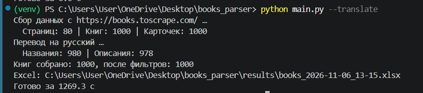
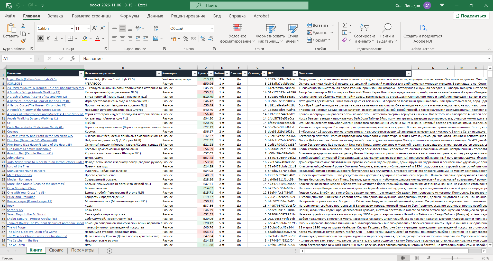
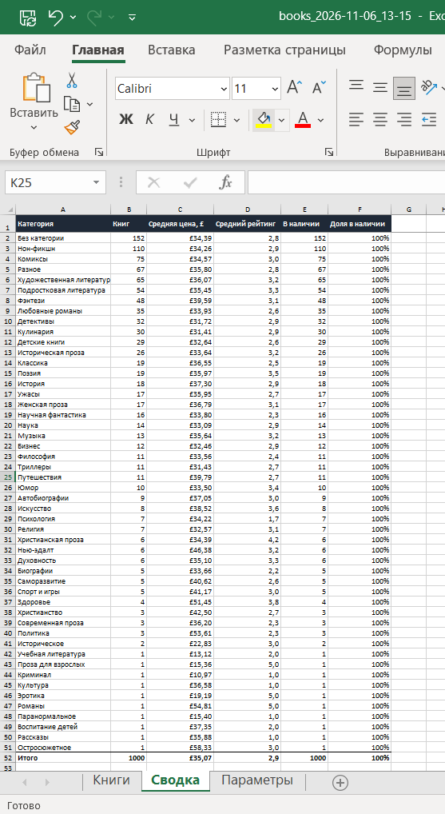

# Парсер интернет-магазина с выгрузкой в Excel

Консольный парсер каталога [books.toscrape.com](https://books.toscrape.com/) — учебного книжного магазина, созданного специально для тренировки парсинга. Собирает все книги по категориям, при необходимости заходит в карточку каждого товара и сохраняет результат в оформленный Excel-файл со сводкой и в CSV.

> Демонстрационный проект. Та же схема подходит для реальных задач: мониторинг цен конкурентов, сбор каталога поставщика, выгрузка объявлений или вакансий.

<p align="center">
  
</p>
<p align="center">
  
</p>
<p align="center">
  
</p>

## Возможности

- Сбор всего каталога (1000 книг, 50 категорий) или только выбранных категорий
- Обход пагинации внутри каждой категории
- Режим `--details`: остаток на складе, артикул (UPC), число отзывов и описание из карточки товара
- Перевод названий и описаний на русский через Google Переводчик (`--translate`); названия переводятся пачками по несколько штук за запрос; два адреса сервиса с автоматическим переключением, паузы между запросами, ожидание при лимитах (HTTP 429) и кеш — повторный запуск не переводит уже переведённое
- Русские названия категорий в отчёте; категорию можно указывать и по-английски, и по-русски
- Фильтры: минимальный рейтинг, максимальная цена, только в наличии
- Параллельная загрузка страниц (по умолчанию 8 потоков) — весь каталог собирается за секунды
- Повтор запросов при сбоях сети и ошибках сервера; одна битая страница не останавливает сбор
- Работа через прокси/VPN (SOCKS)
- Строка прогресса в консоли

**Excel-отчёт**
- Лист «Книги»: название-ссылка на товар, категория, цена, рейтинг, наличие; автофильтр, закреплённая шапка, цветовая шкала цен
- Лист «Сводка»: по каждой категории — число книг, средняя цена, средний рейтинг, доля в наличии. Значения считаются формулами Excel и пересчитываются при правке данных
- Лист «Параметры»: дата выгрузки и условия, с которыми запускался парсер

**CSV** — с разделителем `;` и в кодировке, которую корректно открывает русский Excel.

## Стек

- Python 3.10+
- requests (сессия, повторы запросов) + BeautifulSoup
- openpyxl — генерация Excel
- concurrent.futures — параллельная загрузка
- pytest — тесты на сохранённых HTML-страницах

## Запуск

```bash
git clone <ссылка-на-репозиторий>
cd books_parser
python -m venv venv
venv\Scripts\activate          # Windows
# source venv/bin/activate     # Linux / macOS
pip install -r requirements.txt
python main.py
```

Готовый файл появится в папке `results/`.

## Примеры

```bash
python main.py                                     # весь каталог
python main.py --list-categories                   # список категорий
python main.py -c Travel -c Mystery                # только выбранные категории
python main.py -c Путешествия --translate          # названия и описания на русском
python main.py --details --csv                     # с данными из карточек + CSV
python main.py --min-rating 4 --max-price 30 --in-stock
python main.py -c Poetry --max-pages 1 -o poetry.xlsx
python main.py --help                              # все параметры
```

| Параметр | Что делает |
|---|---|
| `-c`, `--category` | категория; можно указать несколько раз, регистр не важен |
| `--details` | заходить в карточку каждой книги (дольше, но больше данных) |
| `--translate` | перевести названия и описания на русский (включает `--details`) |
| `--check-translator` | проверить доступность Google Переводчика |
| `--max-pages N` | не больше N страниц на категорию |
| `--min-rating 1-5` | минимальный рейтинг |
| `--max-price` | максимальная цена в фунтах |
| `--in-stock` | только книги в наличии |
| `-o`, `--output` | путь к Excel-файлу |
| `--csv` | дополнительно сохранить CSV |
| `--workers N` | число параллельных загрузок |
| `--quiet` | без строки прогресса |

## Тесты

Тесты не ходят в интернет: разбор проверяется на сохранённых страницах из `tests/pages/`, а для проверки полного сбора сеть подменяется.

```bash
pip install pytest
python -m pytest
```

## Структура проекта

```
books_parser/
├── main.py           # командная строка: параметры, фильтры, сохранение
├── scraper.py        # загрузка страниц и разбор HTML
├── models.py         # модель данных «Книга»
├── export.py         # выгрузка в Excel и CSV
├── translate.py      # перевод категорий и описаний, кеш переводов
└── tests/
    ├── test_parser.py
    └── pages/        # сохранённые HTML-страницы для тестов
```

## Возможные доработки

- Выгрузка в Google Таблицы
- Перевод через официальные API (DeepL, Яндекс) для больших объёмов
- Запуск по расписанию и уведомление в Telegram об изменении цен
- Сравнение с прошлой выгрузкой: новые товары, подорожания, снятые с продажи
- Обход защиты для реальных сайтов: ротация прокси, Playwright для страниц на JavaScript
